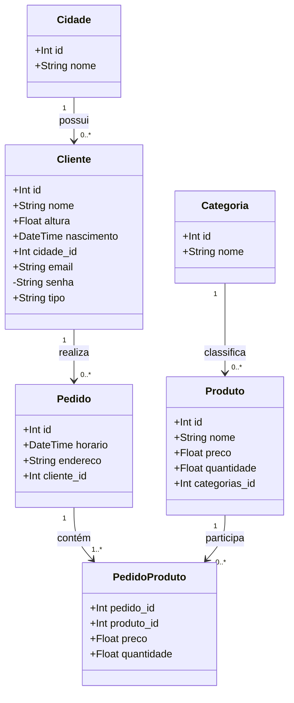
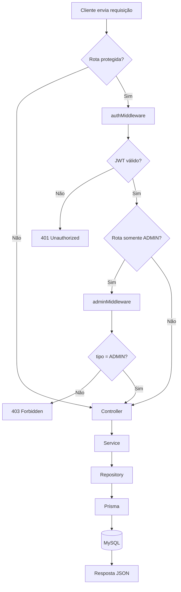
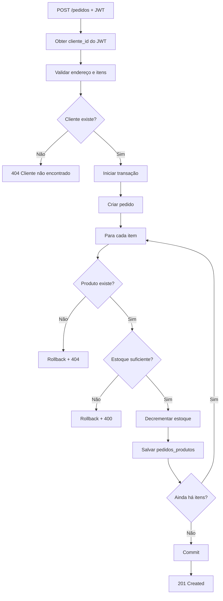
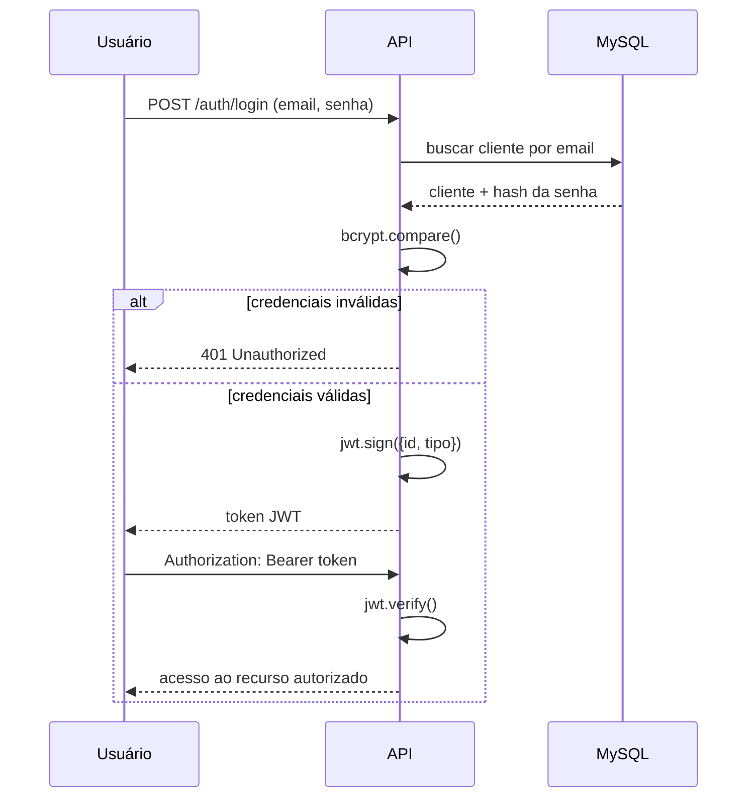

# Diagramas — BattleCry API

Os diagramas abaixo estão em Mermaid e podem ser visualizados diretamente no GitHub ou em editores com suporte a Mermaid.

## Diagrama UML de classes / entidades

## Fluxograma — requisição e autorização

## Fluxograma — criação de pedido

## Fluxo de autenticação

